# MEMORIA NINJA — ARQUITECTURA DEL MÓDULO DE AUTENTICACIÓN

Login · Registro · Verificación · Recuperación de contraseña

Refactor aplicando los 5 principios SOLID y POO (abstracción, encapsulamiento, herencia, polimorfismo) sobre core / servicios / infraestructura / controladores.

_Taller ADSO · Ficha 3172526 · Instructor Andrés Moreno Collazos_

## ARQUITECTURA DEL MÓDULO

Arquitectura en capas → **Composition Root → Controlador → Servicio → Núcleo**

### CAPA 1: COMPOSITION ROOT (`login.js`, `registro.js`, `verificacion.js`, `recuperar.js`)

El Composition Root arma con `new` cada servicio, repositorio y controlador, e inyecta las dependencias concretas. Es el único lugar del módulo que conoce las clases reales.

### CAPA 2: CONTROLADORES (`FormularioControllerBase` + 4 hijos)

Los Controladores (`LoginController`, `RegistroController`, `VerificacionController`, `RecuperacionController`) reciben el evento del formulario y llaman a `manejarEnvio(datos)`, sin saber cómo se valida ni se persiste nada.

### CAPA 3: SERVICIOS (lógica de negocio pura)

Los Servicios (`AutenticacionService`, `RegistroService`, `RecuperacionService`, `VerificacionService`, `SesionService`) contienen las reglas de negocio puras. No tocan el DOM ni `localStorage` directamente.

### CAPA 4: NÚCLEO (`Usuario` + interfaces)

El Núcleo guarda la entidad `Usuario` y los contratos (`IUsuarioLector`, `IUsuarioEscritor`, `ISesionRepositorio`, `INotificador`, `IEnviadorCodigo`, `ICodigoGenerador`) que ninguna otra capa puede romper.

### INFRAESTRUCTURA

`LocalStorageUsuarioRepositorio`, `LocalStorageSesionRepositorio`, `AlertaNotificador`, `MensajeDomNotificador`, `CodigoNumericoGenerador`, `CodigoAlfanumericoGenerador` y `EnvioCodigoModoPrueba` implementan los contratos del Núcleo desde afuera, inyectadas por el Composition Root.

## DIAGRAMA DE ARQUITECTURA

Diagrama de flujo y componentes (uno por proceso en `auth-*-flujo.mermaid`):

```mermaid
flowchart TD
    subgraph Capa1["CAPA 1 — COMPOSITION ROOT"]
        LoginJS["login.js"]
        RegistroJS["registro.js"]
        VerificacionJS["verificacion.js"]
        RecuperarJS["recuperar.js"]
    end

    subgraph Capa2["CAPA 2 — CONTROLADORES"]
        LoginC["LoginController"]
        RegistroC["RegistroController"]
        VerificacionC["VerificacionController"]
        RecuperacionC["RecuperacionController"]
    end

    subgraph Capa3["CAPA 3 — SERVICIOS"]
        AutentS["AutenticacionService"]
        RegistroS["RegistroService"]
        RecuperacionS["RecuperacionService"]
        VerificacionS["VerificacionService"]
        SesionS["SesionService"]
    end

    subgraph Capa4["CAPA 4 — NÚCLEO (contratos)"]
        ILector["IUsuarioLector"]
        IEscritor["IUsuarioEscritor"]
        ISesion["ISesionRepositorio"]
        INotif["INotificador"]
        IEnvio["IEnviadorCodigo"]
        IGen["ICodigoGenerador"]
    end

    subgraph Infra["INFRAESTRUCTURA"]
        RepoUsu["LocalStorageUsuarioRepositorio"]
        RepoSes["LocalStorageSesionRepositorio"]
        NotifDom["MensajeDomNotificador"]
        NotifAlert["AlertaNotificador"]
        CodNum["CodigoNumericoGenerador"]
        CodAlf["CodigoAlfanumericoGenerador"]
        EnvioPru["EnvioCodigoModoPrueba"]
    end

    LoginJS -->|new| LoginC
    RegistroJS -->|new| RegistroC
    VerificacionJS -->|new| VerificacionC
    RecuperarJS -->|new| RecuperacionC

    LoginC --> AutentS
    LoginC --> SesionS
    RegistroC --> RegistroS
    VerificacionC --> VerificacionS
    RecuperacionC --> RecuperacionS

    AutentS -->|DIP -> IUsuarioLector| ILector
    RegistroS -->|DIP -> IUsuarioLector + IUsuarioEscritor| ILector
    RegistroS -->|ISP| IEscritor
    RecuperacionS -->|DIP| ILector
    RecuperacionS -->|DIP| IEscritor
    RecuperacionS -->|DIP| IGen
    VerificacionS -->|DIP| IGen
    SesionS -->|DIP| ISesion
    RecuperacionC -->|DIP| IEnvio
    VerificacionC -->|DIP| IEnvio

    ILector <|.. RepoUsu
    IEscritor <|.. RepoUsu
    ISesion <|.. RepoSes
    INotif <|.. NotifDom
    INotif <|.. NotifAlert
    IGen <|.. CodNum
    IGen <|.. CodAlf
    IEnvio <|.. EnvioPru
    EnvioPru -->|usa para mostrar| INotif
```

## POO — POLIMORFISMO

Polimorfismo: `FormularioControllerBase.manejarEnvio(datos)`.

`controladores/FormularioControllerBase.js`:

```javascript
export class FormularioControllerBase {
  constructor(notificador) {
    if (new.target === FormularioControllerBase)
      throw new Error(...); // abstracta
    this.notificador = notificador;
  }
  // método plantilla: cada subclase
  // lo implementa a su manera
  manejarEnvio() {
    throw new Error("debe implementarse...");
  }
}
```

`LoginController.js`:

```javascript
manejarEnvio(datos) {
  const { usuario, password } = datos;
  this.autenticacionService.iniciarSesion(...);
  this.notificador.mostrar("Acceso concedido");
}
```

`RecuperacionController.js`:

```javascript
manejarEnvio(datos) {
  switch (datos.paso) {
    case "correo": return this.#manejarPasoCorreo(...);
    case "codigo": return this.#manejarPasoCodigo(...);
  }
}
```

Las 4 clases (`LoginController`, `RegistroController`, `VerificacionController`, `RecuperacionController`) heredan de `FormularioControllerBase` e implementan `manejarEnvio(datos)` con la MISMA firma, pero cada una decide qué hacer con esos datos: una inicia sesión, otra distingue 3 pasos internos según `datos.paso`.

## Leyenda SOLID

| Principio | Dónde se aplica en el módulo de autenticación |
|---|---|
| **S** — Responsabilidad Única | `AutenticacionService` solo valida credenciales; `RegistroService` solo valida y crea usuarios; `RecuperacionService` coordina los 3 pasos de recuperación; `VerificacionService` solo genera/valida códigos; `SesionService` solo gestiona la sesión. Ninguno toca el DOM. |
| **O** — Abierto/Cerrado | `ICodigoGenerador`, `IEnviadorCodigo` e `INotificador` permiten nuevas implementaciones (SMS, correo real, toasts) sin tocar los servicios ni controladores existentes. |
| **L** — Sustitución | `CodigoNumericoGenerador` ↔ `CodigoAlfanumericoGenerador` son intercambiables donde se espere un `ICodigoGenerador`; `MensajeDomNotificador` ↔ `AlertaNotificador` igual con `INotificador`. |
| **I** — Segregación de Interfaces | `IUsuarioLector` (solo lectura) e `IUsuarioEscritor` (solo escritura) separadas: `AutenticacionService` depende únicamente de lo que necesita. |
| **D** — Inversión de Dependencias | `login.js`, `registro.js`, `verificacion.js` y `recuperar.js` son los únicos que hacen `new` (composition root). Los servicios reciben las interfaces por constructor, nunca crean `localStorage` ni DOM. |

## Pilar POO

| Pilar | Dónde se aplica |
|---|---|
| Encapsulamiento | `Usuario` expone su estado solo a través de getters y métodos (`verificarPassword()`, `actualizarPassword()`); los atributos van en `#`. |
| Abstracción | Las interfaces del Núcleo (`IUsuarioLector`, `ICodigoGenerador`, ...) definen los contratos que ninguna otra capa puede romper. |
| Herencia | `FormularioControllerBase` (abstracta) → `LoginController`, `RegistroController`, `VerificacionController`, `RecuperacionController`. |
| Polimorfismo | Los 4 controladores implementan `manejarEnvio(datos)` con la MISMA firma pero comportamientos distintos (login, registro, 2 pasos de verificación, 3 pasos de recuperación). |

## SOLID aplicado en detalle

### S — Single Responsibility

| Clase | Responsabilidad única |
|---|---|
| `AutenticacionService.js` | Validar credenciales de login |
| `RegistroService.js` | Validar y crear usuarios nuevos |
| `RecuperacionService.js` | Coordinar los 3 pasos de recuperación |
| `VerificacionService.js` | Generar y validar el código de verificación |
| `SesionService.js` | Guardar / leer / cerrar la sesión activa |
| `LocalStorageUsuarioRepositorio.js` | Persistir usuarios en localStorage |
| `LoginController.js` | Orquestar el formulario de login |

`servicios/AutenticacionService.js`:

```javascript
export class AutenticacionService {
  // DIP: recibe la abstracción, no localStorage
  constructor(repositorioUsuarios) {
    this.repositorioUsuarios = repositorioUsuarios;
  }
  iniciarSesion(usuario, password) {
    const valido = this.repositorioUsuarios
      .buscarPorCredenciales(usuario, password);
    if (!valido) throw new Error("Datos incorrectos");
    return valido;
  }
}
```

### I — Interface Segregation

`IUsuarioRepositorio` se dividió en lectura y escritura. ANTES: una única interfaz mezclaba lectura y escritura, y `AutenticacionService` (que solo necesita leer) estaba obligado a depender de un contrato con métodos que nunca usa (`guardar`, `actualizar`).

```javascript
export class IUsuarioLector {
  obtenerTodos() { ... }
  buscarPorCorreo(correo) { ... }
  buscarPorCredenciales(usuario, password) { ... }
}

export class IUsuarioEscritor {
  guardar(usuario) { ... }
  actualizar(usuario) { ... }
}
```

AHORA: cada servicio depende solo de lo que necesita:
- `AutenticacionService` → depende únicamente de `IUsuarioLector` (nunca ve `guardar`/`actualizar`).
- `RegistroService` → depende de `IUsuarioLector` (verificar correo duplicado) + `IUsuarioEscritor` (guardar).
- `RecuperacionService` → depende de ambas (busca el correo y luego actualiza la contraseña).

### O — Open/Closed y L — Liskov Substitution

El módulo está "abierto para extensión, cerrado para modificación": cada punto de variabilidad (código, envío, notificación, almacenamiento) está encapsulado detrás de una interfaz del Núcleo e inyectado desde el Composition Root.

| Quiero agregar... | Qué hago |
|---|---|
| Nuevo generador de código (SMS) | extends `ICodigoGenerador` + implementa `generar()` |
| Nuevo canal de envío (correo real) | extends `IEnviadorCodigo` + implementa `enviar()` — se cambia UNA línea del composition root |
| Nueva forma de notificar (toast) | extends `INotificador` + implementa `mostrar(mensaje, tipo)` |
| Nuevo repositorio (API REST) | implementa `IUsuarioLector` + `IUsuarioEscritor`, sin tocar los servicios |

LSP: `CodigoNumericoGenerador` y `CodigoAlfanumericoGenerador` implementan `generar()` con la misma firma y pueden sustituirse entre sí sin romper nada. Lo mismo aplica a `AlertaNotificador` ↔ `MensajeDomNotificador`.

## DIAGRAMA DE CLASES

Diagrama de clases (UML). Leyenda de relaciones:
- `──────►` Herencia / generalización (extends)
- `- - - -▷` Implementación (implements / duck typing)
- `─ ─ ─ ─►` Dependencia (usa / crea una instancia)
- `────◇` Agregación ("tiene un")
- `────◆` Composición (ciclo de vida acoplado)

```mermaid
classDiagram

    class Usuario {
        -#string usuario
        -#string nacimiento
        -#string correo
        -#string passwordHash
        +get usuario() string
        +get nacimiento() string
        +get correo() string
        +verificarPassword(passwordIngresada) boolean
        +actualizarPassword(nuevaPassword) void
        +toJSON() object
        +desdeJSON$(objetoPlano) Usuario
    }

    class IUsuarioLector {
        <<interface>>
        +obtenerTodos() array
        +buscarPorCorreo(correo) Usuario
        +buscarPorCredenciales(usuario, password) Usuario
    }

    class IUsuarioEscritor {
        <<interface>>
        +guardar(usuario) void
        +actualizar(usuario) boolean
    }

    class ISesionRepositorio {
        <<interface>>
        +guardar(datosSesion) void
        +obtener() object
        +eliminar() void
    }

    class INotificador {
        <<interface>>
        +mostrar(mensaje, tipo) void
    }

    class IEnviadorCodigo {
        <<interface>>
        +enviar(correo, codigo) void
    }

    class ICodigoGenerador {
        <<interface>>
        +generar() string
    }

    class FormularioControllerBase {
        <<abstract>>
        +INotificador notificador
        +camposVacios(...valores) boolean
        +manejarEnvio() void
    }

    class LoginController {
        +AutenticacionService autenticacionService
        +SesionService sesionService
        +manejarEnvio(datos) void
    }

    class RegistroController {
        +RegistroService registroService
        +manejarEnvio(datos) boolean
    }

    class RecuperacionController {
        +RecuperacionService recuperacionService
        +IEnviadorCodigo enviadorCodigo
        +marcarPaso(numeroActual) void
        +manejarEnvio(datos) boolean
        -#manejarPasoCorreo(correo) boolean
        -#manejarPasoCodigo(codigo) boolean
        -#manejarPasoPassword(nuevaPassword, confirmarPassword) boolean
    }

    class VerificacionController {
        +VerificacionService verificacionService
        +IEnviadorCodigo enviadorCodigo
        +object elementos
        +enmascararCorreo(correo) string
        +enviarCodigo(correo) void
        +manejarEnvio(datos) void
        -#iniciarTemporizador() void
        -#actualizarTemporizadorTexto() void
    }

    class AutenticacionService {
        +IUsuarioLector repositorioUsuarios
        +iniciarSesion(usuario, password) Usuario
    }

    class RegistroService {
        +IUsuarioLector repositorioUsuarios
        +registrar(usuario, nacimiento, correo, pass, confirmarPass) Usuario
    }

    class RecuperacionService {
        -#string codigoActual
        -#string correoActual
        +IUsuarioLector repositorioUsuarios
        +ICodigoGenerador generadorCodigo
        +solicitarRecuperacion(correo) string
        +verificarCodigo(codigoIngresado) boolean
        +cambiarPassword(nuevaPassword, confirmarPassword) void
    }

    class SesionService {
        +ISesionRepositorio sesionRepositorio
        +guardarSesion(usuario) void
        +obtenerSesionActiva() object
        +cerrarSesion() void
    }

    class VerificacionService {
        -#string codigoActual
        -#string correoActual
        +ICodigoGenerador generadorCodigo
        +generarNuevoCodigo(correo) string
        +validarCodigo(codigoIngresado) boolean
        +expirarCodigo() void
        +get correoActual() string
    }

    class LocalStorageUsuarioRepositorio {
        -#guardarTodos(usuarios) void
        +obtenerTodos() array
        +buscarPorCorreo(correo) Usuario
        +buscarPorCredenciales(usuario, password) Usuario
        +guardar(usuario) void
        +actualizar(usuarioActualizado) boolean
    }

    class LocalStorageSesionRepositorio {
        +guardar(datosSesion) void
        +obtener() object
        +eliminar() void
    }

    class MensajeDomNotificador {
        -#string idElemento
        +mostrar(mensaje, tipo) void
    }

    class AlertaNotificador {
        +mostrar(mensaje) void
    }

    class CodigoNumericoGenerador {
        +generar() string
    }

    class CodigoAlfanumericoGenerador {
        -#string caracteres
        -#number longitud
        +generar() string
    }

    class EnvioCodigoModoPrueba {
        +INotificador notificador
        +enviar(correo, codigo) void
    }

    class ModalHelper {
        <<util>>
        +abrirModal$(id) void
        +cerrarModal$(id) void
        +inicializarCierreClicFuera$(ids) void
    }

    class TogglePasswordHelper {
        <<util>>
        +alternarVisibilidadPassword$(idInput, icono) void
    }

    FormularioControllerBase <|-- LoginController : Herencia
    FormularioControllerBase <|-- RegistroController : Herencia
    FormularioControllerBase <|-- RecuperacionController : Herencia
    FormularioControllerBase <|-- VerificacionController : Herencia

    LoginController --> AutenticacionService : inyectado
    LoginController --> SesionService : inyectado
    RegistroController --> RegistroService : inyectado
    RecuperacionController --> RecuperacionService : inyectado
    RecuperacionController --> IEnviadorCodigo : inyectado
    VerificacionController --> VerificacionService : inyectado
    VerificacionController --> IEnviadorCodigo : inyectado

    FormularioControllerBase --> INotificador : DIP via super()

    AutenticacionService --> IUsuarioLector : DIP
    RegistroService --> IUsuarioLector : DIP
    RegistroService --> IUsuarioEscritor : DIP
    RecuperacionService --> IUsuarioLector : DIP
    RecuperacionService --> IUsuarioEscritor : DIP
    RecuperacionService --> ICodigoGenerador : DIP
    SesionService --> ISesionRepositorio : DIP
    VerificacionService --> ICodigoGenerador : DIP

    IUsuarioLector <|.. LocalStorageUsuarioRepositorio : LSP
    IUsuarioEscritor <|.. LocalStorageUsuarioRepositorio : LSP
    ISesionRepositorio <|.. LocalStorageSesionRepositorio : LSP
    INotificador <|.. MensajeDomNotificador : LSP
    INotificador <|.. AlertaNotificador : LSP
    ICodigoGenerador <|.. CodigoNumericoGenerador : LSP
    ICodigoGenerador <|.. CodigoAlfanumericoGenerador : LSP
    IEnviadorCodigo <|.. EnvioCodigoModoPrueba : LSP

    EnvioCodigoModoPrueba --> INotificador : usa para mostrar
    RegistroService --> Usuario : fabrica entidad
```



## CIERRE — Resumen SOLID y notas

- **S** — Responsabilidad Única: `AutenticacionService` solo valida credenciales; `VerificacionService` solo genera/valida códigos; `SesionService` solo gestiona la sesión.
- **O** — Abierto/Cerrado: `ICodigoGenerador`, `IEnviadorCodigo` e `INotificador` permiten nuevas implementaciones (SMS, correo real, toasts) sin tocar código existente.
- **L** — Sustitución: `CodigoNumericoGenerador` y `CodigoAlfanumericoGenerador` son intercambiables; `AlertaNotificador` y `MensajeDomNotificador` también.
- **I** — Segregación: `IUsuarioLector` e `IUsuarioEscritor` separan lectura de escritura; cada servicio depende solo de lo que necesita.
- **D** — Inversión: Servicios y controladores dependen de interfaces del Núcleo, nunca de `localStorage` o del DOM directamente.

### Notas técnicas

- Los códigos se "envían" en modo de prueba (`EnvioCodigoModoPrueba` los muestra en pantalla vía notificador): el backend de correo real aún no existe.
- `SesionService` solo persiste la sesión si el usuario marcó "Recordarme" en `login.html`.
- Diagramas de flujo de ejecución por proceso: `auth-login-flujo.mermaid`, `auth-registro-flujo.mermaid`, `auth-verificacion-flujo.mermaid`, `auth-recuperacion-flujo.mermaid`.

Memoria Ninja · Taller ADSO 3172526 · Módulo de autenticación refactorizado con SOLID + POO