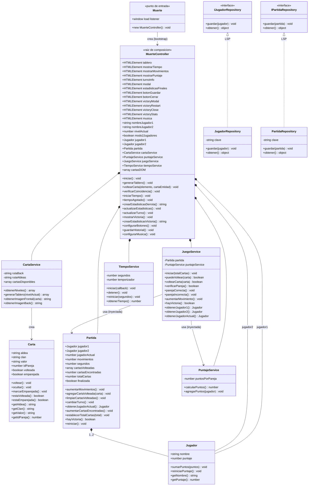

## Leyenda SOLID

| Principio | Dónde se aplica en `js/muerte/` |
|---|---|
| **S** — Responsabilidad Única | `CartaService` (genera cartas/imágenes), `JuegoService` (reglas de juego), `PuntajeService` (cálculo de puntos), `TiempoService` (temporizador): cada uno hace UNA cosa. El `MuerteController` solo orquesta y maneja DOM. |
| **O** — Abierto/Cerrado | Se agrega una implementación nueva de repositorio (ej. `PartidaRepositoryAPI`) sin tocar `IPartidaRepository` ni las ya existentes. |
| **L** — Sustitución | `JugadorRepository` y `PartidaRepository` se pueden intercambiar por cualquier otra clase que cumpla su contrato (`guardar()` / `obtener()`) sin romper al consumidor. |
| **I** — Segregación de Interfaces | `IJugadorRepository` tiene solo `guardar`/`obtener`; `IPartidaRepository` igual. Cada interfaz expone exactamente lo que su implementación ofrece. |
| **D** — Inversión de Dependencias | `MuerteController` es la única raíz de composición (único lugar donde se hace `new` de servicios/entidades). `JuegoService` recibe `partida` y `puntajeService` por constructor, no los crea. |

## Pilar POO

| Pilar | Dónde se aplica |
|---|---|
| Encapsulamiento | Entidades (`Carta`, `Jugador`, `Partida`) exponen su estado interno solo a través de métodos/getters (`getAldea()`, `getPuntaje()`, `estaVolteada()`). |
| Abstracción | `IJugadorRepository` / `IPartidaRepository` definen el contrato y lanzan "método debe ser implementado" si se usan directo. |
| Herencia | `JugadorRepository extends IJugadorRepository`, `PartidaRepository extends IPartidaRepository`. |
| Polimorfismo | Cualquier implementación de repositorio (localStorage hoy, servidor mañana) se usa igual por su interfaz. |

# Diagrama de clases — `js/muerte/` (Modo Muerte)

Modo de juego "Muerte" reestructurado en capas con POO y SOLID.

## Nota

Los repositorios (`JugadorRepository`, `PartidaRepository`) están definidos pero **aún no conectados** al `MuerteController`: hoy la persistencia del historial se hace directo al `localStorage` dentro del controller (`guardarHistorial()`).
